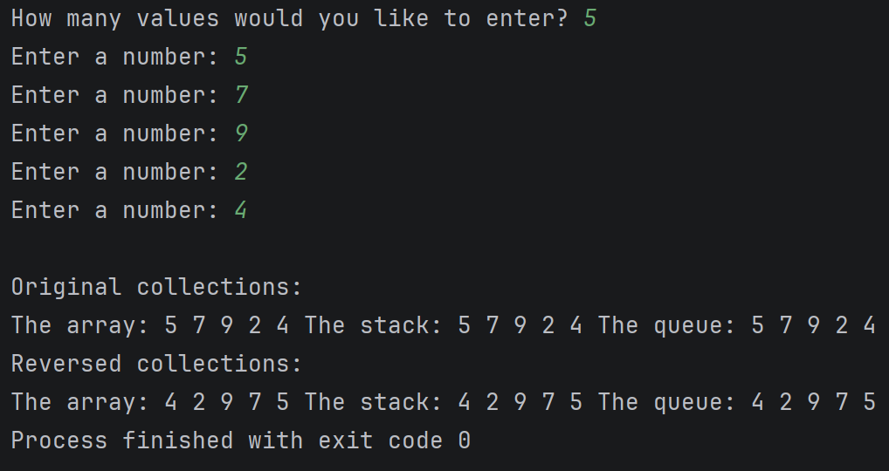

# Reversal of Arrays, Queues, and Stacks

This program allows a user to choose in how many values they would like to enter, and then lets them define those values. It will then show the user those values printed in their normal state, and then will show the user those values in a reversed state.

# Running this program:

First, build the program into a .jar file, and then run the program by using java -jar ReverseCollections.jar. You can also clone this project, and do `cd ReversingArraysStacksQueues/src` followed by `java Main.java`.

# Output

